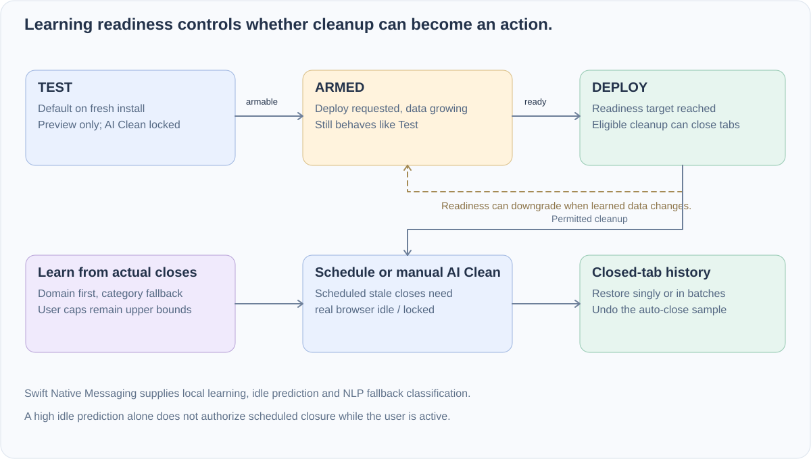

<div align="center">


# Neural-Janitor · Chrome / Edge Tab Manager

**Learn which tabs deserve to stay. Preview cleanup before letting it act.**

[](companion/NeuralJanitorCompanion/Package.swift) [](extension/manifest.json) [](LICENSE)

**English** · [简体中文](README_CN.md)

[Install](#setup-instructions) · [First session](#your-first-session) · [Decision logic](#how-decisions-work) · [Code guide](#explore-the-code)

</div>

If you work with 60+ open tabs on macOS, you've probably tried—and uninstalled—timer-based auto-close extensions. Fixed timers treat every tab the same: they kill the PR or API reference you still need, while leaving 15 disposable Google search tabs cluttering your window.

Neural-Janitor pairs a Chrome / Edge extension with a local Swift companion (`The Chronos Engine`). Instead of enforcing a dumb countdown, it watches **when you actually hit `Cmd+W`** (`manual_browser_close`), combines root-domain history, page category, foreground dwell time, and interaction count, and learns how long *you* tend to keep different kinds of pages around. Core ML idle-window prediction and Apple `NaturalLanguage` classification run entirely on-device to support that policy.

Requires **macOS 13+, Chrome / Edge, and a Swift toolchain**. Fresh installs always start in **Test** (preview-only) mode—nothing is closed behind your back until the learner has seen enough of your real habits and you explicitly enable **Deploy**.

## What makes it behave differently

| Mechanism | How the code actually implements it |
| --- | --- |
| **Preview first, earn trust later** | Fresh installs start in `Test` mode (candidates are tagged, never closed). Moving through `Test → Armed → Deploy` is gated by real learning progress in [deployment-readiness.js](extension/js/deployment-readiness.js). |
| **Measures background idle, not "opened at"** | Stale checks compare `now - lastBackgroundedAt` alongside foreground dwell and interaction count—a 3-day-old tab you just read 10 minutes ago stays untouched. |
| **Doesn't train on its own auto-closes** | In [closure-learner.js](extension/js/closure-learner.js), manual closes carry `1.0` weight (ignoring `<15s` misclicks), while auto-cleanups are damped to `0.2` context weight. Restoring an auto-closed tab **deletes its sample** so mistakes are unlearned immediately. |
| **Search results live in their own bucket** | SERP pages are routed into `Search Results` / `search:<engine>` buckets ([search-results.js](extension/js/search-results.js)). Closing Google searches in 30 seconds won't shorten the lifetime of Google Docs or Gmail. |
| **Shared learning across Chrome & Edge** | Both browsers talk to the same local Swift companion over Native Messaging stdio (`~/Library/Application Support/Neural-Janitor/`), sharing one retention store and Core ML model. |
| **Real idle gating + holiday awareness** | Scheduled stale cleanup waits for the browser's actual `idle` / `locked` state, and factors in a 7-day workday/weekend/holiday lookahead so a Monday holiday doesn't use a Tuesday workday prior. |

## How decisions work



| Mode | What you see | What can happen |
| --- | --- | --- |
| `Test` | Stale candidates and live learning stats | Preview only; automatic and AI Clean closures stay locked. Fresh-install default. |
| `Armed` | You requested `Deploy`, and the learner has at least **3 manual closes + 1 learned bucket** | Continues running in preview until it reaches the full readiness threshold. |
| `Deploy` | At least **5 manual closes + 2 learned buckets** (with a `safer` milestone at **10 + 3**) | Eligible scheduled and manual cleanup can close tabs and write one-click recovery records. |

[deployment-readiness.js](extension/js/deployment-readiness.js) owns these transitions and automatic downgrades: if you reset or lose readiness, `Deploy` steps back down to `Armed` or `Test`.

Close-time learning is always the primary authority. Even if the Core ML predictor estimates a high idle probability, scheduled cleanup will **not** close tabs while you are actively using the browser. Manual **AI Clean** in the popup is an explicit on-demand action that can trim a small batch of low-value background tabs when you want breathing room right now.

## Setup Instructions

Native Messaging requires a native host manifest on macOS. Chrome / Edge cannot install that host silently, so a one-time install step is still required unless the companion is packaged as a signed installer.

### 1. Clone or open the repository

```bash
git clone https://github.com/dubianche123/neural-janitor-tab-manager.git
cd neural-janitor-tab-manager
```

### 2. Load the extension

Open `chrome://extensions` or `edge://extensions`, enable Developer Mode, choose **Load unpacked**, and select:

```text
extension/
```

Copy the extension ID shown by the browser.

### 3. Build and link the companion

```bash
chmod +x scripts/install.sh
./scripts/install.sh YOUR_CHROME_EXTENSION_ID [YOUR_EDGE_EXTENSION_ID]
```

Reload the extension afterward. The companion starts when the extension opens a Native Messaging connection.
If Chrome and Edge end up with different extension IDs, pass both so the native host manifest allows both browsers.
The installer places the companion at `~/Library/Application Support/Neural-Janitor/NeuralJanitorCompanion`.
Native Messaging connections are short-lived: the browser opens the host for a request, receives one response, then disconnects so browser shutdown is not blocked.

### 4. After companion changes

If the Swift companion or native host metadata changes, rerun:

```bash
./scripts/install.sh YOUR_CHROME_EXTENSION_ID [YOUR_EDGE_EXTENSION_ID]
```

## Your first session

1. Open the popup and confirm **Test** mode and the companion's connection status.
2. Browse normally and close tabs you are finished with. Those manual decisions create the useful training signal.
3. Use **Preview** to inspect proposed stale tabs; check domain/category learning and readiness in the popup.
4. Request Deploy when you want cleanup enabled. If learning is only armable, it enters Armed until ready.
5. After a permitted close, inspect the closed-tab log and try restoring one record.

For example, repeatedly closing search results quickly should teach the isolated search bucket; it should not automatically shorten the lifetime of unrelated mail or work pages on the same broad provider. Domain recommendations take precedence over broad category recommendations where available.

Recovery first tries a browser session restore when a session ID exists, then falls back to reopening the recorded URL. It is not a backup of unsaved page state. The restoration path and sample removal are in [background.js](extension/js/background.js).

## Architecture

### 1. Tab Interaction Tracker

The tracker records when a tab enters foreground, leaves foreground, how long it stayed there, and how often you interacted with it. Cleanup compares `now - lastBackgroundedAt` against an effective close time instead of relying on simple "opened at" age.

### 2. Manual Closure Learner

Manual closes are the primary signal. The learner stores category, root domain, foreground dwell, background age, and interactions, then recommends close times from meaningful manual samples. Domain-level patterns adapt first; category-level patterns require broader evidence across multiple domains. Automatic cleanup samples are kept as context only so the system does not train on its own decisions.

### 3. Local Page Classifier

The browser classifies pages with a domain map and content signals first. When confidence is low, the Swift companion uses Apple `NaturalLanguage` to score the page title, description, and text. The browser also keeps a small root-domain category memory so repeat sites do not keep falling back to `Other`.

### 4. Auxiliary Idle Predictor

The companion trains a 9-feature `TrainingSample` model from local activity history. That model is deliberately auxiliary: it influences idle-context multipliers and the ML console, while close-time learning remains the main decision source. Automatic stale closure waits for Chrome's real `idle` / `locked` state; a high model prior alone is not permission to close tabs while you are active.

### 5. Holiday-Aware Idle Windows

The browser sends per-day holiday levels for the next seven calendar dates to the companion. This lets a Monday holiday change Monday's prediction even if today is a normal workday. Workday and weekend/holiday sleep-wake windows act as priors, not hard cleanup rules.

### 6. Memory Pressure Cleanup

AI Cleanup scores tabs by learned close-time pressure, engagement, interaction count, and category as a weak tie-breaker. Lower-value, low-interaction, long-idle tabs are cleaned first. Test mode stays preview-only. When Deploy is active and you manually run AI Clean, the extension can still trim a small batch of obviously low-value background tabs.

## Category Closure Time Rules

Tabs are assigned a close time from four inputs: category defaults, learned manual-close behavior, root-domain history, and per-tab importance. Root-domain history wins over broad category history whenever it exists, so one fast-closing site does not teach the whole category to close early. Search result pages are isolated into `Search Results` and `search:<engine>` buckets. The Settings sliders are caps, not replacements; the model can close sooner, but it cannot keep a tab longer than the configured maximum.

| Category | Max Idle Time | Rationale |
|----------|--------------|-----------|
| **NSFW** | **12 hours** | Opened once, walked away. Close quickly. |
| Search Results | 12 hours | Disposable by default, then adapts from your SERP close behavior. |
| Social Media | 3 days | Fast-decaying value. |
| Entertainment | 5 days | Often revisit-able but not work-critical. |
| News | 5 days | Freshness matters. |
| Shopping | 7 days | Useful, but not indefinitely. |
| Other | 7 days | Conservative default for uncategorized pages. |
| Reference | 10 days | Documentation and articles often stay relevant. |
| Work & Productivity | 14 days | PRs, tickets, and drafts need time. |
| Email & Communication | 14 days | Session continuity can matter. |
| **Finance & Banking** | **30 days** | High-value sessions, but not permanent. |
| **AI Tools** | **30 days** | Long-running research and chat sessions are often intentional. |

## Moving The Local Model Between Macs

Neural-Janitor stores learned artifacts in:

```text
~/Library/Application Support/Neural-Janitor/
```

Do not live-sync that folder through iCloud while the companion is running. Use the export/import scripts instead.

### Export on the source Mac

```bash
./scripts/export_model_bundle.sh --output ~/Desktop
```

To include raw activity history as well:

```bash
./scripts/export_model_bundle.sh --with-events --output ~/Desktop
```

### Import on the target Mac

Install Neural-Janitor first, then run:

```bash
./scripts/import_model_bundle.sh ~/Desktop/neural-janitor-model-bundle-YYYYMMDD-HHMMSS.tar.gz
```

To intentionally restore `activity_events.json` too:

```bash
./scripts/import_model_bundle.sh --with-events ~/Desktop/neural-janitor-model-bundle-YYYYMMDD-HHMMSS.tar.gz
```

The import script verifies checksums and backs up any existing local artifacts under:

```text
~/Library/Application Support/Neural-Janitor/backups/
```

Reload the browser extension after importing so the companion reloads the model.

## Using The Popup

- **Preview**: Tags stale tabs immediately without closing anything.
- **AI Clean**: Header cleanup reduces tab or memory pressure toward your targets. Suggestion-card trims are bounded separately as `Clean safest` and `Clean more`.
- **AI Suggestions**: Shows separate cards for tab/memory pressure, stale-tab preview, and low-importance cleanup, while keeping Deploy/Test readiness separate.
- **Reset Model State**: Clears closure learning, domain-memory shortcuts, idle predictions, and the local companion artifacts.
- **MEM / CPU**: Shows current memory pressure, CPU usage, and compact CPU model / thread count.
- **ML Insights**: Shows idle windows for the next seven days with workday, weekend, or holiday labels.
- **Settings**: Controls companion usage, calendar selection, close-time caps, whitelist, timed blacklist, and AI Cleanup targets.

If you prefer the terminal, run:

```bash
scripts/reset_model_state.sh
```

## Explore the code

| Responsibility | Source |
| --- | --- |
| Browser events, scheduling, cleanup and restoration | [background.js](extension/js/background.js) |
| Manual-close recommendations and sample handling | [closure-learner.js](extension/js/closure-learner.js) |
| Test / Armed / Deploy transitions | [deployment-readiness.js](extension/js/deployment-readiness.js) |
| Cleanup ranking | [cleanup-ranking.js](extension/js/cleanup-ranking.js) |
| Page categories and isolated search buckets | [categorizer.js](extension/js/categorizer.js), [search-results.js](extension/js/search-results.js) |
| Popup controls and explanations | [popup.js](extension/js/popup.js), [popup.html](extension/popup.html) |
| Native host, training, prediction and local storage | [Swift companion](companion/NeuralJanitorCompanion/Sources/main.swift) |
| Native host registration and model migration | [scripts/](scripts/) |

The browser handles tab permissions and actions. The companion supplies local learning and predictions through **length-prefixed JSON over Native Messaging stdio**. The installer registers the extension IDs allowed to connect to that host. [Detailed C4 source](docs/readme/runtime-detail.mmd) is retained for a component-level view.

## Security And Privacy

- **No cloud analytics**: Activity logs, models, and tab registries stay on the Mac and in extension local storage.
- **No remote tracking scripts**: The extension does not inject remote code or analytics pixels.
- **Local model only**: Core ML training and inference stay on-device.
- **Native Messaging boundary**: Browser JS and Swift communicate with length-prefixed local JSON over stdio.

## Development Checks

```bash
node --check extension/js/background.js
node --check extension/js/content.js
node --check extension/js/constants.js
node --check extension/js/categorizer.js
node --check extension/js/holidays.js
node --check extension/js/idle-detector.js
node --check extension/js/popup.js
node --check extension/js/storage.js
python3 -B -m py_compile scripts/train_model.py
bash -n scripts/install.sh
bash -n scripts/uninstall.sh
bash -n scripts/export_model_bundle.sh
bash -n scripts/import_model_bundle.sh
swift build -c release --package-path companion/NeuralJanitorCompanion
```

## License

Open-sourced under the [MIT License](LICENSE). Because Native Messaging requires a local host manifest on macOS, load the unpacked extension in Developer Mode and run `./scripts/install.sh` once to register the Swift companion.

<p align="center"><sub>Neural-Janitor: Edge-Accelerated Tab Hygiene — The Chronos Engine</sub></p>
