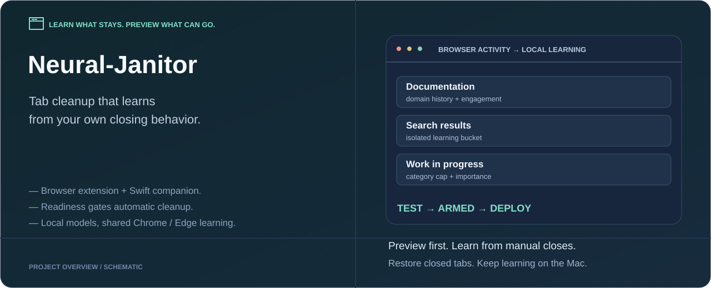
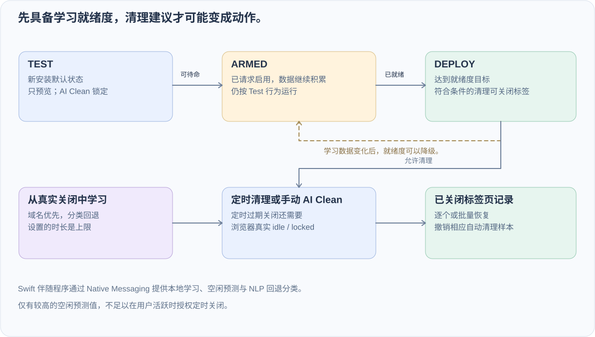

<div align="center">



# Neural-Janitor · Chrome / Edge 标签页管理

**从你的真实关闭行为中学习，先预览，再让清理真正执行。**

[](companion/NeuralJanitorCompanion/Package.swift) [](extension/manifest.json) [](LICENSE)

[English](README.md) · **中文**

[安装](#安装指南) · [第一次使用](#第一次使用) · [决策机制](#清理决策怎样形成) · [代码导航](#代码导航)

</div>

面向经常打开大量标签页的 macOS 用户。当前需要 **macOS 13+、Chrome / Edge 与 Swift 工具链**；按[安装指南](#安装指南)加载扩展并安装本地伴随程序，第一次使用默认 Test 预览模式。

Neural-Janitor 由 Chrome / Edge 扩展与本地 Swift 伴随程序组成。它学习**你实际在什么时候关闭标签页**，再结合域名历史、页面分类、使用投入和配置上限，给出清理建议。Core ML 空闲预测与本地页面分类为这个策略提供辅助信号。

文档、一次性搜索结果与持续处理的工作页面，不该共用一个固定寿命。项目的核心是完整反馈闭环：**观察 → 学习 → 预览 → 满足条件后执行 → 必要时恢复**。

## 可以体验什么

| 体验 | 当前实现 |
| --- | --- |
| 预览过期页面 | 新安装默认 **Test**；查看候选项，不直接关闭。 |
| 学习个人保留习惯 | 手动关闭产生域名/分类建议；Chrome 与 Edge 共享原生学习数据。 |
| 区分搜索结果 | 搜索页使用独立 `Search Results` / `search:<engine>` 学习桶。 |
| 控制自动清理 | 就绪度决定 Test / Armed / Deploy；定时过期关闭还检查浏览器真实空闲状态。 |
| 检查决策输入 | 弹窗展示手动/自动样本、已学习桶数、就绪度与本地运行时状态。 |
| 恢复已关闭页面 | 支持单个或批量恢复；恢复自动关闭项会删除对应学习样本。 |

## 清理决策怎样形成



| 模式 | 看到什么 | 可以发生什么 |
| --- | --- | --- |
| `Test` | 候选项与学习状态 | 只预览，AI Clean 锁定；这是新安装默认状态。 |
| `Armed` | 已请求 Deploy，但学习仍在积累 | 继续按 Test 运行，达到就绪目标后再激活。 |
| `Deploy` | 清理已启用 | 符合条件的定时或手动清理可以关闭标签页，并写入恢复记录。 |

当前门槛为 **3 次手动关闭 + 1 个已学习桶**可以待命，**5 次手动关闭 + 2 个已学习桶**达到就绪。这些是启动门槛，不是统计准确率保证。[deployment-readiness.js](extension/js/deployment-readiness.js) 定义门槛与降级逻辑：过早请求启用会保持 Test；失去就绪度后，Deploy 可以退回 Armed 或 Test。

关闭时间学习是主要决策来源。仅有较高的空闲预测值，**不足以**在用户活跃时授权定时关闭。手动 AI Clean 是用户明确请求的另一条路径，低于目标标签数时仍可小批量清理低价值后台页。

## 安装指南

Native Messaging 需要在 macOS 上安装一个 native host manifest。Chrome / Edge 不能静默安装这个 host，所以仍然需要一次性的安装步骤，除非把伴随程序打包成签名安装器。

### 1. 克隆或打开仓库

```bash
git clone https://github.com/dubianche123/device-native-tab-hygiene.git
cd device-native-tab-hygiene
```

### 2. 加载扩展

打开 `chrome://extensions` 或 `edge://extensions`，启用 Developer Mode，选择 **Load unpacked**，然后选中：

```text
extension/
```

复制浏览器显示的 Extension ID。

### 3. 构建并链接伴随程序

```bash
chmod +x scripts/install.sh
./scripts/install.sh YOUR_CHROME_EXTENSION_ID [YOUR_EDGE_EXTENSION_ID]
```

之后重新加载扩展。扩展发起 Native Messaging 连接时，伴随程序会自动启动。
如果 Chrome 和 Edge 的扩展 ID 不一样，就把两个 ID 都传给脚本，这样 native host manifest 会同时允许两边。
安装脚本会把伴随程序放在 `~/Library/Application Support/Neural-Janitor/NeuralJanitorCompanion`。
Native Messaging 连接是短连接：浏览器每次请求启动 host，拿到一次响应后主动断开，避免拖住浏览器退出。

### 4. 伴随程序变化后

如果 Swift 伴随程序或 native host 元数据变化了，再运行一次：

```bash
./scripts/install.sh YOUR_CHROME_EXTENSION_ID [YOUR_EDGE_EXTENSION_ID]
```

## 第一次使用

1. 打开弹窗，确认处于 **Test**，并检查伴随程序连接状态。
2. 正常浏览，手动关闭已经看完的页面。这些真实决定才是有用的训练信号。
3. 使用 **Preview** 检查过期候选项，并查看域名/分类学习与就绪状态。
4. 希望启用清理时请求 Deploy。如果仅达到可待命门槛，会进入 Armed，继续等待学习。
5. 发生一次允许的关闭后，打开关闭记录，尝试恢复其中一项。

例如，经常快速关闭搜索结果，应当主要教会独立搜索桶；不应因此直接缩短同一大型网站下邮件、工作页面的寿命。有域名建议时，域名历史优先于宽泛分类。

恢复时优先尝试浏览器会话恢复；没有可用会话时，回退为重新打开记录的 URL。它不是未保存页面状态的备份。恢复与样本删除逻辑见 [background.js](extension/js/background.js)。

## 架构

### 1. 标签页交互追踪器

追踪器记录标签页什么时候进入前台、什么时候离开前台、在前台停留了多久，以及交互了多少次。清理时比较的是 `now - lastBackgroundedAt`，而不是单纯看“打开多久了”。

### 2. 手动关闭学习器

手动关闭是主信号。学习器会保存分类、根域名、前台停留、后台年龄和交互次数，再从有意义的手动样本中推荐关闭时间。根域名模式会先适应；类别级模式需要更多、跨多个域名的证据。自动清理样本只作为上下文记录，不会拿来反过来训练系统自己。

### 3. 本地页面分类器

浏览器先用域名映射和页面信号进行分类。置信度不高时，Swift 伴随程序会用 Apple `NaturalLanguage` 对标题、描述和正文打分。浏览器侧还会保留一个很小的根域名分类记忆，让重复站点不要一直掉回 `Other`。

### 4. 辅助闲置预测器

伴随程序会从本地活动历史训练一个 9 特征的 `TrainingSample` 模型。这个模型是辅助角色：它影响闲置情境倍率和 ML 控制台，而真正的主学习器仍然是关闭时间学习。自动 stale 关闭等待 Chrome 真实报告 `idle` / `locked`；单独一个很高的模型先验不会在你仍然 active 时关闭标签页。

### 5. 节假日感知闲置窗口

浏览器会把未来七个自然日的节假日等级发送给伴随程序。这样即使今天不是假日，周一如果是日本或中国节假日，周一的预测也会单独变化。工作日和周末/假期的睡眠窗口只是先验，不是硬性清理规则。

### 6. 内存压力清理

AI Cleanup 会按照学到的关闭压力、参与度、交互次数和类别做弱权重排序。低价值、低交互、长时间闲置的标签页优先被清理。Test 模式只做预览，不会真正关闭。Deploy 生效后，手动触发 AI Clean 时，即使当前还没到压力阈值，也可以主动清掉一小批明显不重要的后台标签页。

## 分类关闭时间规则

标签页的关闭时间由四部分决定：类别默认值、手动关闭学习、根域名历史和单个标签页的重要度。只要某个根域名已经学到自己的关闭时间，它会优先于宽泛的大类经验，避免一个网站把整个类别带偏。搜索结果页会被隔离进 `Search Results` 和 `search:<engine>` 学习桶。设置里的滑块只是上限，不是替换；模型可以更早关闭，但不会超过你设定的最大值。

| 分类 | 最大闲置时间 | 说明 |
|----------|--------------|------|
| **NSFW** | **12 小时** | 打开一次就走，不等闲置窗口。 |
| Search Results | 12 小时 | 默认就是偏一次性的页面，之后会按你的 SERP 关闭习惯适应。 |
| Social Media | 3 天 | 价值衰减很快。 |
| Entertainment | 5 天 | 常回看，但通常不是工作核心。 |
| News | 5 天 | 新鲜度很重要。 |
| Shopping | 7 天 | 有用，但不该无限期保留。 |
| Other | 7 天 | 未分类页面的保守默认值。 |
| Reference | 10 天 | 文档和文章往往还能继续参考。 |
| Work & Productivity | 14 天 | PR、工单和草稿需要时间。 |
| Email & Communication | 14 天 | 会话连续性有时很重要。 |
| **Finance & Banking** | **30 天** | 高价值会话，但不是永久的。 |
| **AI Tools** | **30 天** | 长时间的研究和对话窗口通常是有意保留的。 |

## 在多台 Mac 之间迁移本地模型

Neural-Janitor 的学习成果保存在：

```text
~/Library/Application Support/Neural-Janitor/
```

不要在伴随程序运行时用 iCloud 直接同步这个目录。请改用导出 / 导入脚本。

### 在源 Mac 上导出

```bash
./scripts/export_model_bundle.sh --output ~/Desktop
```

如果你还想连原始活动历史一起迁移：

```bash
./scripts/export_model_bundle.sh --with-events --output ~/Desktop
```

### 在目标 Mac 上导入

先正常安装 Neural-Janitor，再执行：

```bash
./scripts/import_model_bundle.sh ~/Desktop/neural-janitor-model-bundle-YYYYMMDD-HHMMSS.tar.gz
```

如果你故意想恢复 `activity_events.json`：

```bash
./scripts/import_model_bundle.sh --with-events ~/Desktop/neural-janitor-model-bundle-YYYYMMDD-HHMMSS.tar.gz
```

导入脚本会校验 checksum，并把旧文件备份到：

```text
~/Library/Application Support/Neural-Janitor/backups/
```

导入后重新加载浏览器扩展，让伴随程序重新载入模型。

## 弹窗怎么用

- **Preview**：立刻给 stale 标签页打标，不会关闭任何页面。
- **AI Clean**：顶部按钮用于把标签页数量或内存压力压回目标；AI Suggestions 里的 `Clean safest` / `Clean more` 是单独限量的小批量清理。
- **MEM / CPU**：显示当前内存压力、CPU 占用，以及简短的 CPU 型号 / 线程数。
- **ML Insights**：显示未来七天的闲置窗口，包含工作日、周末或节假日标签。
- **Settings**：控制是否使用伴随程序、日历选择、关闭时间上限、白名单、定时黑名单和 AI Cleanup 目标。
- **AI Suggestions**：把标签页数量/内存压力、stale 预览、低重要度清理拆成独立卡片；Deploy/Test 就绪状态会单独显示。
- **Reset Model State**：清空关闭学习、域名记忆、idle 预测和本地 companion 学习文件。

如果你更习惯命令行，直接运行：

```bash
scripts/reset_model_state.sh
```

## 代码导航

| 职责 | 源码 |
| --- | --- |
| 浏览器事件、定时清理与恢复 | [background.js](extension/js/background.js) |
| 手动关闭建议与样本处理 | [closure-learner.js](extension/js/closure-learner.js) |
| Test / Armed / Deploy 状态转换 | [deployment-readiness.js](extension/js/deployment-readiness.js) |
| 清理排序 | [cleanup-ranking.js](extension/js/cleanup-ranking.js) |
| 页面分类与独立搜索桶 | [categorizer.js](extension/js/categorizer.js)、[search-results.js](extension/js/search-results.js) |
| 弹窗控制与说明 | [popup.js](extension/js/popup.js)、[popup.html](extension/popup.html) |
| 原生宿主、训练、预测与本地存储 | [Swift 伴随程序](companion/NeuralJanitorCompanion/Sources/main.swift) |
| 宿主注册与模型迁移 | [scripts/](scripts/) |

浏览器负责标签页权限与动作，伴随程序通过 **Native Messaging stdio 上带长度前缀的 JSON** 提供本地学习与预测。安装脚本注册允许连接宿主的扩展 ID。[详细 C4 源码](docs/readme/runtime-detail-cn.mmd) 保留了组件视角。

## 安全与隐私

- **没有云端分析**：活动日志、模型和标签页注册表都保留在本机和扩展本地存储中。
- **没有远程追踪脚本**：扩展不会注入远程代码或分析像素。
- **纯本地模型**：Core ML 训练和推理都在设备上完成。
- **Native Messaging 边界**：浏览器 JS 和 Swift 通过长度前缀的本地 JSON over stdio 通信。

## 开发检查

```bash
node --check extension/js/background.js
node --check extension/js/content.js
node --check extension/js/constants.js
node --check extension/js/categorizer.js
node --check extension/js/holidays.js
node --check extension/js/idle-detector.js
node --check extension/js/popup.js
node --check extension/js/storage.js
python3 -B -m py_compile scripts/train_model.py
bash -n scripts/install.sh
bash -n scripts/uninstall.sh
bash -n scripts/export_model_bundle.sh
bash -n scripts/import_model_bundle.sh
swift build -c release --package-path companion/NeuralJanitorCompanion
```

<p align="center"><sub>Neural-Janitor：边缘加速的标签页卫生管理 —— Chronos 引擎</sub></p>

## 许可证

[MIT](LICENSE)。当前安装方式需要浏览器开发者模式和 macOS 原生宿主注册；仓库尚不是签名后的商店发行包。
